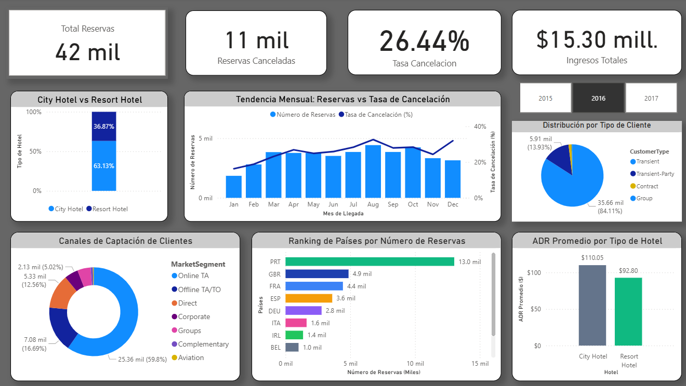

# Análisis y predicción de cancelaciones hoteleras

Una cancelación cambia la planificación de un hotel: deja habitaciones disponibles y puede afectar los ingresos esperados. Este proyecto explora los patrones de las reservas y utiliza Machine Learning para estimar su posible cancelación.

El trabajo reúne un análisis en Python, un dashboard en Power BI y una demostración interactiva en Hugging Face Spaces.

**[Explorar el simulador](https://huggingface.co/spaces/JuanTF/Modelo_Predictivo_Cancelacion_Reserva_Hotel)** · **[Ver el notebook](notebooks/hotel_booking_cancellation.ipynb)** · **[Descargar el informe de Power BI](power-bi/hotel_booking_dashboard.pbix)**

## Vista del dashboard

El panel permite explorar reservas y cancelaciones por año, comparar City Hotel y Resort Hotel, revisar la tendencia mensual e identificar los principales países, canales de captación y tipos de cliente. También presenta la tarifa diaria promedio (ADR) por hotel.

La captura corresponde al filtro de **2016**: muestra aproximadamente 42 mil reservas, 11 mil cancelaciones y una tasa de cancelación de 26,44 %. Son indicadores descriptivos del informe, no métricas del modelo predictivo. La tarjeta «Ingresos Totales» se presenta tal como está en el PBIX; su fórmula y moneda deben verificarse antes de interpretarla como ingresos efectivamente cobrados.

## Qué se desarrolló

- Preparación de datos: revisión de tipos, duplicados y valores faltantes.
- Análisis exploratorio de reservas, perfiles y comportamiento de cancelación.
- Codificación de variables categóricas y escalado de variables numéricas.
- Entrenamiento de regresión logística, árbol de decisión, Random Forest y XGBoost.
- Selección de variables con Random Forest y ajuste de XGBoost mediante RandomizedSearchCV.
- Visualización de indicadores de reservas en Power BI.
- Demostración de predicciones mediante una aplicación publicada en Hugging Face.

## Datos y objetivo

El notebook carga un CSV público desde [BPA---Datasets](https://github.com/JuanTF/BPA---Datasets/blob/main/hotel_bookings.csv). La salida inicial guardada registra **119 390 filas y 33 columnas**. En etapas posteriores aparecen **87 409 registros** después de la limpieza. Son cifras de la ejecución conservada, no un recálculo de esta edición.

La variable objetivo es `is_canceled`: **1 indica cancelación y 0 indica que no se canceló**. El conjunto incluye datos de llegada, duración de la estancia, historial del cliente, canal de reserva, depósito y tarifa diaria.

El CSV no se incluye en este repositorio. Consulta [la nota de datos](data/README.md) para conocer la fuente que utiliza el código.

## Resultados del notebook

La evaluación final guardada de XGBoost muestra los siguientes resultados, redondeados a tres decimales:

| Métrica | Resultado |
| --- | ---: |
| Accuracy | 0,772 |
| Precision | 0,553 |
| Recall | 0,917 |
| F1 | 0,690 |
| ROC AUC | 0,907 |

Precision, recall y F1 corresponden a la clase de cancelación. La matriz guardada contiene 17 482 observaciones:

| Resultado real | Predicción: no cancelación | Predicción: cancelación |
| --- | ---: | ---: |
| No cancelación | 9 041 | 3 592 |
| Cancelación | 401 | 4 448 |

Con esa configuración se detectó aproximadamente el 92 % de las cancelaciones, aunque también se generaron numerosas falsas alarmas. Por eso el recall debe leerse junto con la precisión, y no como un porcentaje general de aciertos.

Estos resultados pertenecen a la ejecución histórica del notebook. El preprocesamiento se ajustó antes de separar entrenamiento y prueba, lo que limita la evaluación. No se ha realizado una validación independiente ni se ha comprobado que estas métricas correspondan al modelo actualmente publicado en Hugging Face. Los detalles se explican en [notas técnicas](docs/technical-notes.md).

## Demostración interactiva

[**Abrir el simulador de cancelación de reservas**](https://huggingface.co/spaces/JuanTF/Modelo_Predictivo_Cancelacion_Reserva_Hotel)

La aplicación permite introducir datos de una reserva y consultar la clasificación y las probabilidades estimadas por un modelo XGBoost. Es una demostración de portafolio; su preprocesamiento manual requiere ajustes para coincidir con el notebook. No debe utilizarse como una herramienta validada para tomar decisiones sobre reservas reales.

El código y los archivos de la aplicación se mantienen en [Files del Space](https://huggingface.co/spaces/JuanTF/Modelo_Predictivo_Cancelacion_Reserva_Hotel/tree/main). Este repositorio contiene el análisis y el informe de Power BI; no incluye una copia del modelo desplegado.

## Organización del repositorio

| Ruta | Contenido |
| --- | --- |
| `notebooks/hotel_booking_cancellation.ipynb` | Limpieza, exploración, modelos y evaluación |
| `power-bi/hotel_booking_dashboard.pbix` | Informe editable de Power BI |
| `docs/images/hotel_booking_dashboard.png` | Vista previa del informe |
| `docs/technical-notes.md` | Alcance, cambios y limitaciones técnicas |
| `data/README.md` | Fuente de datos y condiciones de reproducción |
| `requirements.txt` | Dependencias del notebook |
| `artifacts/` | Carpeta generada durante la ejecución, excluida de Git |

## Cómo explorar o ejecutar el proyecto

### Notebook

1. Descarga o clona el repositorio.
2. Instala las dependencias: `pip install -r requirements.txt`.
3. Abre `notebooks/hotel_booking_cancellation.ipynb` con Jupyter o súbelo a Google Colab.
4. Ejecuta la configuración inicial y continúa en orden. El CSV se descarga desde la URL del notebook; necesitas acceso a internet.
5. Los archivos intermedios se guardan en `artifacts/`. En Colab son temporales si no los descargas.

El notebook conserva la estructura de desarrollo original. Las rutas fueron adaptadas y se desactivó una propuesta de GridSearch incompatible con sus parámetros. No se volvió a entrenar el proyecto completo. La búsqueda de 100 configuraciones con cinco particiones puede requerir bastante tiempo y memoria. La visualización de árboles con Graphviz necesita también el programa Graphviz instalado en el sistema.

### Power BI

Abre `power-bi/hotel_booking_dashboard.pbix` con Power BI Desktop. Si necesitas actualizar los datos, revisa **Transformar datos → Configuración de origen de datos** y adapta las rutas de las consultas a tu equipo. El informe se incluye con su modelo incorporado; no se han reconstruido sus consultas ni verificado su actualización en otro equipo.

## Herramientas

Python · pandas · NumPy · scikit-learn · XGBoost · SciPy · Matplotlib · seaborn · Google Colab · Power BI · Gradio · Hugging Face Spaces

## Próximos pasos

Unificar el entrenamiento y la aplicación mediante un pipeline exportado, ajustar las transformaciones solo con datos de entrenamiento y realizar una evaluación temporal con variables disponibles en el momento de la predicción. También queda por revisar la definición de ingresos y documentar el origen y la licencia del dataset antes de redistribuirlo.

## Autoría

Repositorio mantenido por **Juan Manuel Tafur Recuay**. El material conserva su origen académico y referencias de trabajo grupal; esta presentación no atribuye en exclusiva las contribuciones de otras personas.
